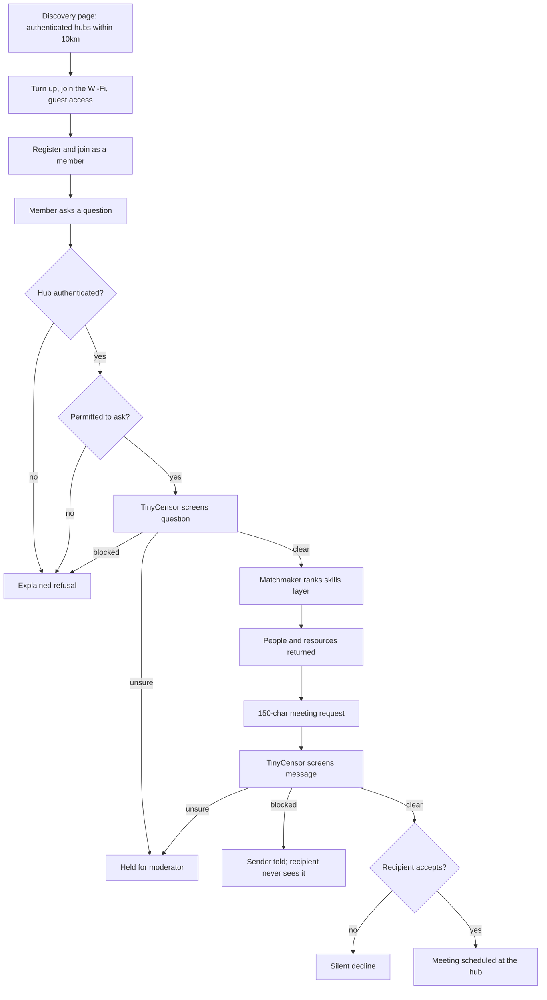
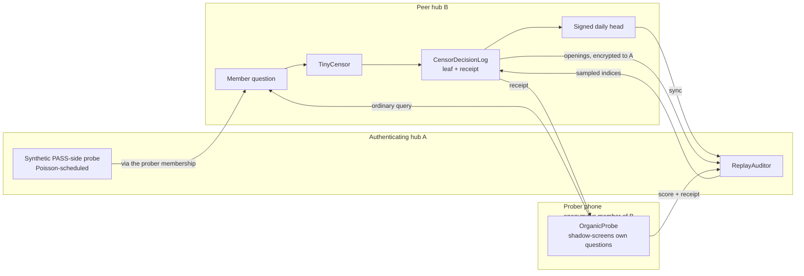
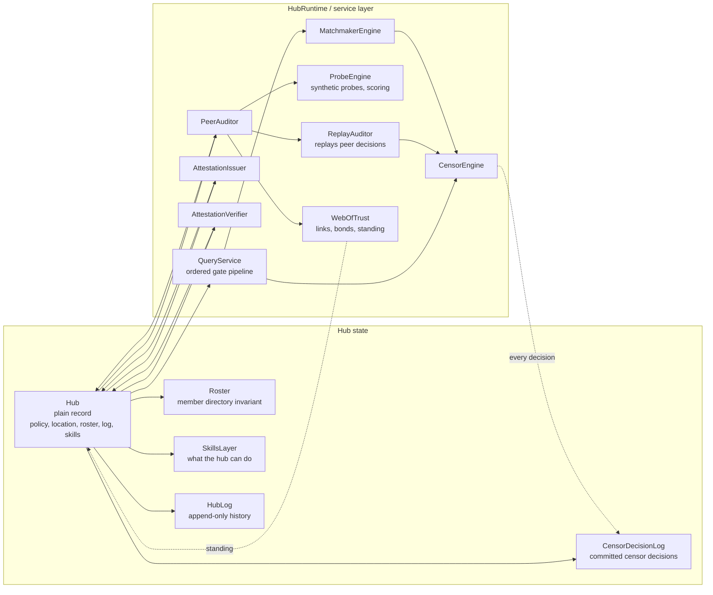
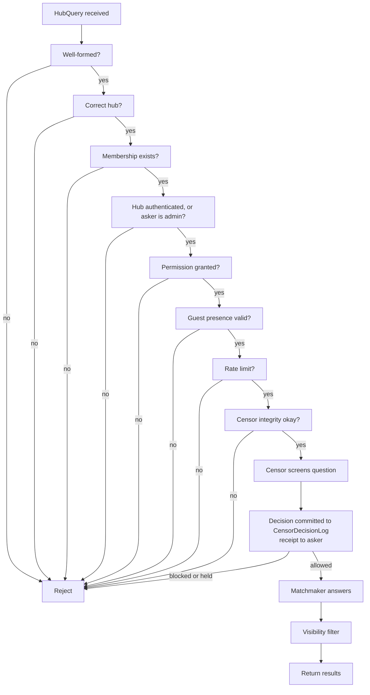

# Shalim

A knowledge discovery and redundancy mobile app.

Shalim connects knowledge communities — libraries, makerspaces, mutual aid
groups, community gardens — and keeps them working when the internet does not.
Each community runs a **hub**: a self-contained index of what its members and
its resources can actually do. When someone needs help, they ask their hub, and
the hub answers from within itself. No server is required, and nothing stops
working during a blackout.

---

## ⚠️ Status: hub core and inter-hub checks built on stub models; discovery and real models still skeleton

**Stages 1–4 of 7 are done:**
- crypto and identity primitives;
- transport and network claims;
- the hub core: creation, roster, roles and restrictions, policy, the query
  pipeline, meeting requests, earning skills, attestations, retention, and
  encrypted persistence;
- inter-hub authentication: link setup, replay, organic and synthetic probes,
  `WebOfTrust`, revocation and appeal, and provisional status.

All of this is real code with tests. A hub can be created, run, searched,
saved and reloaded, and one hub can check another and revoke it. It all runs
on fixed-output *stub* models, though, and discovery and the real models are
still pseudo-code. The anonymous prober credential is a seam with no
implementation, so **no link can be set up outside the tests** until a
scheme is chosen (question 18). See *Build order* and the stage sections
below.

- No models are bundled or integrated. `TinyCensor`, `QwenMatchmaker` and
  `TinyProber` are interface implementations with no inference behind them.
  The hub core runs on `FixedCensor` and `KeywordMatchmaker` (`ml.stub`).
  These are deliberately not safety controls.
- No Android project, no Gradle build, no UI. Persistence is an encrypted file
  store for desktop hub instances; the Android store is still to come.
- One real transport: IP on a local network (`LanTransport`). Bluetooth
  mesh, LoRa and cellular are specified by capability and simulated in
  memory with their real limits, including LoRa duty cycle. Their radios
  arrive with the Android build.
- **None of the safety controls below are enforced.** They are designed, not
  built. The primitives they will rest on have had no independent review. Do
  not deploy this near real users.

The skeleton exists to settle architecture — who can see what, what travels
between hubs, what happens when the network dies — before any of it is
implemented.

---

## The idea

A member opens a chat with their hub and asks something ordinary:

> *"I want to start a permaculture garden on my balcony. Who can help?"*

The hub screens the question, matches it against its **skills layer**, and
returns people and resources that fit — a neighbour who learnt grafting in the
orchard workshop, a book on the shelf, a wormery in the back room. The member
can send one short message to anyone the query returned, and if that person
accepts, they meet at the hub.

Skills come from resources. Every hub starts with an explicit list of what it
holds; the Matchmaker derives the hub's **hub skills** from that list, and
those are what strangers see in hub search. People earn **user skills** by
using those resources, verified by an admin, and carry them on their own
device to every hub they belong to.

That is the whole product. The complexity below exists to make it safe.

## How it fits together



## Prober changes (30 September 2026)

The previous revision had one weakness it could not design around: **the hub
being checked knew who was checking it.** It had to. The prober sent a request
to buy drugs or weapons every day, and without being told who they were, the
hub would have restricted them within a week. `PeerAuditor.isInboundProber`
existed to grant that exemption — and it was exactly the hook a dishonest hub
needed to answer the prober correctly and everyone else however it liked.
Knowing the prober also made authentication a lever against a named person.

This revision removes the need for the target to know. It does that by
no longer sending supply requests at all, then making the prober anonymous,
then making what remains of probing look like ordinary use.

### What changed

| | Before | Now |
| --- | --- | --- |
| **How the censor is tested** | Daily synthetic probes, one designed to be blocked | **Replay**: the peer commits every censor decision to a signed Merkle tree (`CensorDecisionLog`); the auditor opens a random sample and replays it through its own pinned TinyCensor (`ReplayAuditor`) |
| **Supply requests sent to peers** | One a day, every day | **None, ever.** `TrustProbe.sendableToPeer()` is false for `SUPPLY_SIGNAL`; those seeds are used for local self-test only |
| **Who the target thinks the prober is** | A named member, registered by user id | **An anonymous ordinary member.** The prober presents a `MemberCredential` (BBS) proving "ordinary, attested, joined ≥ 14 days ago"; the target records a pseudonym |
| **Moderation exemption for the prober** | `isInboundProber` | **Deleted.** Nothing the prober sends needs one |
| **Rate limiting the prober** | Per user id | **`EpochNullifier`** (RLN-style): one presentation per member per link per day; a second one mathematically reveals the member |
| **Shared-admin check** | Salted hashes — which let the target hash every member and name the prober | **`AdminOverlapCheck`**: private set intersection *cardinality*; the target learns only a count |
| **Device attestation** | Sent at link setup, naming the prober's key | Checked **at join** for every member who can attest; carried as a hidden credential attribute |
| **Behavioural probes** | Fixed daily pair | **Organic** (the prober's own real questions, shadow-screened on their device, `OrganicProbe`) plus **synthetic PASS-side** probes at a **Poisson** rate scaled to the peer's traffic |
| **Quiet or small hubs** | Probed like any other, so probes stood out | **`REPLAY_ONLY` mode**: below a traffic band, or below 8 eligible members, no questions are sent at all |
| **Plaintext on the auditor's device** | A fortnight of drug-request texts (as hash + seed) under the admin's identity | No supply text at all; replayed member questions are decrypted, replayed and discarded in one call |

### The three evidence streams



1. **Replay (every link; 30 real leaves a fortnight).** B signs a head for each day's tree.
   A reveals that day's value from a nonce chain it committed to at link
   setup, B checks it against the chain's anchor, both derive sample indices
   from `PRF(nonce, head)`, and B opens those leaves — plaintext encrypted to
   A only. A replays each through its own pinned TinyCensor. Because the model
   is deterministic and B committed before the sample existed, one mismatch
   beyond tolerance is near-proof, not a statistic. This is now the **only**
   test of under-blocking. It does not depend on B being fooled, so it is fine
   that B knows *A* is replaying it.
2. **Organic (FULL links).** The prober's device screens their own outgoing
   question with its local pinned TinyCensor, keeps B's receipt, later checks
   the receipt is in B's tree, and forwards only the score and receipt to A.
   A checks the receipt against the head *it* was given. This catches the two
   things replay cannot: screenings routed around the log, and B showing
   different auditors different trees. Every member's device checks its own
   receipts routinely, so the prober doing so marks no one out.
3. **Synthetic (FULL links).** Benign, protected-speech and near-miss probes
   only, weighted to protected speech. Their job is now narrow: over-blocking
   of harm-reduction, abortion-access and border-safety questions, which a
   prober's own questions rarely touch. Sent at exponentially distributed
   intervals with a mean of ~2% of B's traffic (max 3/day), inside the
   prober's usual active hours — so some days have none, like any member.

### How a link is set up now

1. A's admin, an ordinary member of B for at least 14 days, asks to set up
   authentication.
2. A and B run `AdminOverlapCheck`. B learns only whether they share an admin.
3. The admin's device presents today's `MemberCredential` for B. B verifies it
   against its own issuer key, checks the nullifier, and checks the member is
   not already carrying a link for another hub (the prober pseudonym).
4. B records an inbound link under a **link pseudonym**. No user id exists
   anywhere on B's side.
5. If B has fewer than 8 ordinary, attested, old-enough members, the link runs
   `REPLAY_ONLY` and nothing is ever sent under the admin's membership.
6. Credentials expire daily and are never issued to admins, so promotion to
   admin in B ends the link the same day, as before.

### Mode selection

| Condition | Mode | What runs |
| --- | --- | --- |
| B's anonymity set ≥ 8 and traffic band ≥ 2 (≈ 64 padded screenings/day) | `FULL` | Replay + organic + synthetic |
| B's anonymity set < 8 | `REPLAY_ONLY` | Replay, reduced to a small weekly sample |
| B's traffic band < 2 | `REPLAY_ONLY` | Replay |
| `HIGH_RISK` posture | `FULL` without synthetic (anonymity threshold 12) | Replay (batched weekly over sync) + organic |

### What is still exposed

- **B knows *some* member probes for A.** It does not know which. In a hub at
  exactly the threshold, eight people is a small crowd.
- **Replay reads real member questions.** A sample of B's members' questions
  is decrypted on A's hub instance. The text never contains a user id, is
  never displayed or stored, and the sample is fixed by the root and a
  pre-committed nonce so A cannot aim it at one person — but in a small hub a
  question can identify its author on its own content.
- **Meeting requests are replayed** at every hub (decided 19 November 2026;
  question 16). A hub that withholds them fails replay, whatever its posture.
- **Determinism is an engineering commitment.** Replay requires every hub to
  screen on the reference CPU backend with fixed threading. Leaves within
  ±0.005 of a threshold are excluded from findings.
- **Attestation now reaches every member who can attest**, not only probers.
  Members who cannot attest lose nothing except the ability to be a prober.

## Build order

Pseudo-code is replaced from the bottom of the dependency graph up. The LLMs
stay deterministic stubs until the protocol logic around them is proven.

1. **Crypto and identity primitives, plus storage and audit-log formats.**
   ✅ Done 29 October 2026.
2. **Transport and network claims: device-to-hub messaging, claim queries,
   the creation listen, members' pinned claims, sync.** ✅ Done 29 October
   2026.
3. **Hub core without AI: creation, roster, roles and restrictions, policy
   defaults, retention, persistence. Fixed-output stubs stand in for the three
   models.** ✅ Done 18 November 2026.
4. **Inter-hub authentication against those stubs: link setup, replay,
   organic and synthetic streams, `WebOfTrust`, revocation.** ✅ Done 19
   November 2026.
5. Hub search, bonds and dispute handling.
6. Real models, in this order: TinyCensor (the safety gate), then
   QwenMatchmaker, then the prober. The prober's difference scores can only be
   calibrated against real Matchmaker outputs.
7. Client UI and hardening.

Before each stage starts, its pseudo-code is turned into tests, so the
pseudo-code stays the spec.

## Crypto and identity primitives (29 October 2026)

### What is now real code

| Where | What |
| --- | --- |
| `org.shalim.crypto` (new) | SHA-256 with a canonical, domain-tagged, length-prefixed encoding for everything hashed or signed (`Canonical`); Ed25519 (`Ed25519`, `Signer`, `SoftwareSigner`); key fingerprints (`Fingerprints`); X25519 (`X25519`, `EncryptionKeyPair`); HKDF and HMAC (`Hkdf`, `Prf`); unbiased PRF-driven sampling (`Prf.sampleDistinct`); ChaCha20-Poly1305 at rest (`Aead`); anonymous-sender encryption to a key (`SealedBox`); RFC 9162 Merkle trees and inclusion proofs (`Merkle`); commit-then-reveal nonce chains (`HashChain`); Shamir sharing over GF(2^8) (`Shamir`); the keystore seam (`AccountKeyStore`, `SoftwareAccountKeyStore`) |
| `identity` | `User` ids are key fingerprints; `sign`, `publicKey`, `verify`; `DeviceBinding` enforces one account slot per device over the keystore; guest expiry and upgrade |
| `hub.HubLog` | Hash-chained, signed entries; chain and signature verification; `entriesMissingFrom` and `mergeEntries` for linear sync; pruning that re-anchors the chain; wipe |
| `hub.CensorDecisionLog` | All of it: salted leaves, padding, daily signed heads chained day to day (including empty days), signed receipts, inclusion proofs, openings sealed to the auditor, plaintext encrypted at rest, retention, wipe |
| `hub.NetworkClaim` | Keyed BSSID hashes, `covers`, signing, peer witnesses, signed migration |
| `ml.ModelPin`, `trust.ProbeCorpus` | Artefact hash checks, release signatures, matching |
| `attestation.Attestation` | Issue, verify, validity window, refresh |
| `trust.ReplayAuditor` | `sampleIndices`, `revealNonce`, `verifyRevealedNonce` |

All algorithms come from the JDK, so there are still no dependencies. The tests
include the published vectors from FIPS 180-2, RFC 4231, RFC 5869, RFC 7748 and
RFC 8032, and they all pass.

### Design changes made along the way

Turning the pseudo-code into code exposed six problems. Each is fixed in the
code and noted where it bites.

1. **The replay nonce could not be verified.** The old pseudo-code revealed
   `HMAC(nonceSecret, day)` against a commitment `H(nonceSecret)`. The peer
   cannot check an HMAC without the key, and once it has the key it knows every
   future nonce. So an auditor could reveal any nonce after seeing the root and
   aim the sample at one member's question, which is the very thing sampling
   exists to prevent. The fix is a hash chain: the anchor `H^N(seed)` is
   committed at setup, and day *k*'s nonce `H^(N−k)(seed)` checks against it
   and gives nothing away about day *k+1*.
2. **A salted BSSID hash must be a keyed hash with a secret salt.** BSSIDs are
   48 bits, and vendor prefixes shrink that further. Anyone who holds the salt
   can brute-force every hash. `saltedBssidHash` is HMAC-SHA256 keyed by the
   salt, and the salt is treated as a key.
3. **Leaf text hashes are now salted.** `sha256(text)` on a seized hub device
   would let an adversary confirm a guessed question. The text hash now uses the
   leaf's salt, and the auditor checks the text with the salt from the opening.
4. **Auditors must check leaf fields against the leaf hash.** An inclusion
   proof covers only the hash. Without that check, a peer could show an
   auditor a different decision under a genuine leaf. Hence
   `Leaf.hashMatches()`.
5. **Guest upgrade keeps the key.** `DeviceBinding` and `GuestUser.upgrade`
   disagreed. The code follows `DeviceBinding`: the slot changes, the key and
   user id stay the same, and skill credentials need no re-binding.
6. **Hubs need a separate encryption key.** The issuer key (Ed25519) signs,
   and an X25519 key receives openings. Peers need it at link setup.

### Signature changes

Keys are passed in, never stored on state classes ("services depend on state;
state never depends on services"). So these methods gained a `Signer` and,
where plaintext is stored, an at-rest key:

- `HubLog.append(..., Signer, Instant)`
- `HubLog.mergeEntries(entries, keyLookup)`
- `CensorDecisionLog.append(..., Signer, atRestKey, Instant)`
- `CensorDecisionLog.close(day, Signer, Instant)`
- `CensorDecisionLog.open(day, indices, auditorKey, atRestKey, includeMeetingRequests)`
- `NetworkClaim.migrate(hashes, Signer, Instant)`, which used to take raw private-key bytes
- `GuestUser.upgrade(DeviceBinding, Instant)`

`DeviceBinding.bind` now takes the slot kind and returns the new key, because
the user id is derived from the key and so has to come after it.

`Verdict` gained a data constructor.

### Deliberately still pseudo-code

- **BBS credentials, RLN nullifiers, PSI-cardinality, linkable ring
  signatures** (`MemberCredential`, `EpochNullifier`, `AdminOverlapCheck`,
  `BondProof`, `SkillCredential`). The schemes are unchosen (question 18), and
  writing them by hand would be the riskiest code in the project.
- **Device key attestation** (`DeviceBinding.attest` and `verifyAttestation`).
  It is platform code, needs real device chains to test, and **fails closed**:
  until it is done, no member counts as attested, so nobody can act as a
  prober.
- **Recovery shares**. `Shamir` is ready, but see question 21.
- Everything that *uses* these primitives to make a decision: link setup,
  `replay()`, receipt checks, `NetworkClaim.older`, issuing policy. That is
  stages 2 to 4.

## Transport and network claims (29 October 2026, stage 2)

### What is now real code

| Where | What |
| --- | --- |
| `transport.SecureChannel` | Mutually authenticated, forward-secret sessions (SIGMA-I: X25519, Ed25519, HKDF, ChaCha20-Poly1305). Both identities are encrypted, and the initiator's is revealed only after it has verified the responder. Data frames have counter nonces and a 64-frame replay window |
| `transport.Wire`, `LogEntryCodec`, `ClaimFrames`, `MessageType` | A compact, strictly bounded wire format; malformed input fails as one exception type and the frame is dropped |
| `transport.SyncService` | Transport selection per job; replica sync (handshake, HELLO with log head and censor pin, entries the other side lacks in frames that fit the transport, merge through `HubLog.mergeEntries`); beacons; meeting-request delivery; card gossip; claim answering; `verifyPresence` |
| `transport.LanTransport` | The first real transport: TCP for sessions, UDP broadcast for claim queries, beacons and cards |
| `transport.InMemoryNetwork` | A simulated medium enforcing each transport's frame limits and LoRa's 1% duty cycle, recording what an eavesdropper would see. Used by the tests and for running several hubs in one process |
| `transport.TransportProfile`, `LoRaAirtime`, `AirtimeBudget` | Capability figures per transport; the Semtech time-on-air formula; rolling-hour duty-cycle accounting |
| `transport.Beacon` | Rolling, keyed beacons ("I exist, here's my log head") that only the hub's own replicas can recognise |
| `transport.ClaimQueryClient` | Claim queries from a device: the probe behind the creation check, and `confirmAttached` |
| `transport.PeerEndpoint` | Session-based authentication; censor pin comparison |
| `hub.NetworkClaimService` | The creation check (stable access points, this device's pins, ten minutes asking the network), `createClaim`, `answer`, `resolveDispute` |
| `hub.ClaimAnswer`, `ClaimPins`, `Bssid` | Nonce-bound signed answers; device-side pins; access-point stability checks |
| `hub.NetworkClaim` | `older()` by trusted, dated witnesses; summaries without BSSID hashes |
| `hub.HubNetwork`, `PresenceProof`, `PremisesCode` | Wi-Fi attachment, signed presence proofs lasting minutes, refresh, rotating single-use premises codes |
| `trust.AuditSchedule.permits` | Refuses observable transports unless allowed |

### Design changes made along the way

1. **Pinned claims needed a device-local key.** The creation check was meant
   to test a device's pinned claims against the network. But a claim's BSSID
   hashes are keyed with the hub's salt, which the device does not and must
   not have. `ClaimPins` instead stores `HMAC(deviceKey, bssid)` for each
   access point the hub has answered for, so a pin can be checked on this
   device and nowhere else.
2. **Witnesses now date themselves.** A witness used to sign the claim's own
   `claimedAt`, which the claiming hub chooses. A backdated claim with a
   colluding witness would then look old. A witness now signs its own
   `witnessedAt` too, and `older()` compares the earliest witness date the
   judging device trusts. The witness format is now v2.
3. **Beacons no longer broadcast who and how busy.** The beacon carried the
   hub's identity and log head in the clear. The head changes with every
   event, so it worked as an activity meter for anyone with a radio. Beacons
   now carry a token that rolls every 15 minutes and an encrypted head. Only
   replicas holding the beacon key can read them.
4. **Devices check attachment by asking, not by hashing.** `HubNetwork.isAttached`
   assumed a device could hash its BSSID with the hub's salt. Instead, a
   device sends a claim query with a fresh nonce. A signed answer from the
   hub's key for the access point it is on is the device's own proof of being
   there (`ClaimQueryClient.confirmAttached`). Hub-side, `isAttached` checks
   the same thing for the presence proof it then issues.
5. **Challenge-response became sessions.** `PeerEndpoint.authenticate(challenge,
   response)` proved once that the peer held a key, but bound nothing that
   followed to it. Every frame after the handshake is now sealed to the session.
6. **Heartbeats spend no handshake.** Over LoRa, `syncWith(HEARTBEAT)`
   compares the head from the last beacon and reports the gap without a
   three-frame handshake. A handshake costs 0.54 s of airtime at SF7, out of
   36 s an hour.
7. **Log sync merges only on matching censor pins.** A replica advertising a
   different TinyCensor artefact gets nothing merged, and the outcome is
   flagged. Raising `CensorIntegrity` from that flag belongs to stage 3.

### Signature changes

- `SyncService(hubId, transports, channelKey, beaconKey, clock)` replaces
  both old constructors, and configuration is fluent (`serve`,
  `withCensorPin`, `authorising`, `answeringClaims`, …).
- `Transport` gained `broadcast`, `maxBroadcastBytes` and `close`.
- `PeerEndpoint.authenticate(challenge, response)` is now
  `authenticated(session, now)`.
- `NetworkClaimService.mayCreateHubHere(observed, attached, pins, probe[, listen])`
  returns a `CreationResult`, and `resolveDispute` returns a `Resolution`.
- `NetworkClaimService.answer(nonce, bssid, hubKey, salt)`
- `NetworkClaim.older(a, b, trustedKeys)` takes public keys, not just
  fingerprints.
- `NetworkClaim.witness(peerKey, now)`
- `HubNetwork.issuePresenceProof(..., hubKey, now)` returns a
  `PresenceProof`.
- `HubNetwork.canRefresh(proof, device, stillAttached)`

### Deliberately not yet

- **Bluetooth mesh, LoRa and cellular radios.** These are platform code
  (stage 7). The profiles and the in-memory medium fix what those
  implementations must honour.
- **Model fetch** (`Job.MODEL_FETCH`). The job is defined, and chunked transfer
  verified against `ModelPin` arrives with model integration (stage 6).
- **Skills layer in `FULL_SYNC`.** It needs persistence (stage 3). Until then
  FULL_SYNC carries the log.
- **Inter-hub head distribution and replay openings over sessions.** These
  belong to stage 4, which will use `SecureChannel` and the same framing.
- **`BLUETOOTH_PROXIMITY` and `MEMBER_VOUCHED` attachment.** They fail closed:
  the first needs a BLE beacon, the second signed vouches (stage 3).
- **Card format.** `gossip()` carries opaque bytes until stage 5 defines
  signed cards.

## Hub core (18 November 2026, stage 3)

### What is now real code

| Where | What |
| --- | --- |
| `identity` | `Role` permission sets (each role includes the one below); `Membership` with restriction caps, the hub-standing cap and plain-language denials; `Restriction` with scope, discharge and accountable lifting; `AgeAssurance` with expiry and strength ordering; `User` join, leave and permission checks; guest upgrade carrying memberships, wallet and skills |
| `hub.HubPolicy` | Posture defaults; validation that flags inconsistency and loosening; the disclosure members see before joining; setters, applied only through `HubAdministration.changePolicy` |
| `hub.HubStanding`, `CensorIntegrity` | The standing derivation, failing open after unlock; local and peer integrity checks; failure modes that never mean "carry on unscreened" |
| `hub.HubLocation` | Redaction at source, with coordinates rounded once and never jittered; an opening-hours grammar; first-meeting suitability; distance |
| `hub.HubAdministration` (new) | Hub creation; admitting members and walk-in guests; roles, restrictions, removal and leaving; roster and log views, which are themselves logged; resources; earning skills; moderation outcomes and appeals; integrity; standing; retention; panic wipe. Each action checks permission under the hub's standing and is logged |
| `hub.QueryService` | All nine gates for real: rate limits, failure modes, a censor-log leaf and receipt for every screened question, roster filtering of matches whatever the engine returned, and screening of generated prose |
| `query` | `HubQuery`, `QueryResult` (refused, held or answered, always with a reason); `MeetingRequest` with contact-detail filtering and a compact frame; `Meeting` booked only at the hub in opening hours; `MeetingBook` (new); `MeetingService` (new) with provenance, once-per-pair, held-request review, silent decline and reporting that blocks the pair |
| `skills` | The whole `SkillsLayer`: screened resources, hub-skill derivation with stable ids, interactions, verification, credential import with de-duplication, keyword and vector search, rescreening, retention. A credential-scheme seam (`SkillCredentialScheme`) with no implementation in the main tree |
| `attestation` | Wallet (presents one proof, never the set); issuer (withholds good standing from a flagged hub); verifier (fails open in a blackout); moderation outcomes that cite evidence, expire within a year and are appealed to someone else |
| `ml.stub` (new) | `FixedCensor` and `KeywordMatchmaker`: deterministic stand-ins so everything above can be tested before real models exist |
| `store` (new) | `EncryptedStore`: named records sealed under a wrapped data key, atomic writes, crypto-shredding. `StoreKey`: PBKDF2-SHA256 at 600,000 iterations. `HubSnapshot`: a whole hub to bytes and back, byte-for-byte, refusing any snapshot whose log does not verify |

### Design changes made along the way

1. **Members can no longer list the roster.** `VIEW_MEMBERS` had sat with
   members. It now belongs to moderators: a member who could list the roster
   would hold the directory that "no cold contact" exists to deny them.
   Members find people only through query results.
2. **Hub creation became a service.** A constructor cannot screen
   resources, check the claim signature or write the log. So
   `HubAdministration.create` does all of that, refuses incomplete hubs with
   every reason at once, and the seven-argument `Hub` constructor is gone.
3. **An unscreened verdict is REVIEW, never ALLOW.** A `Verdict` nobody
   produced must not clear anything. Without a verified censor, questions and
   meeting requests are held, not passed.
4. **Opening hours have a grammar.** They were free text, which could not
   enforce "meetings cannot be scheduled outside these". Hours now read like
   `Mon-Fri 09:00-17:00; Sat 22:00-02:00; Sun closed` in a named time zone.
   Hours that do not parse host no meetings until an admin fixes them.
5. **Location rounding is stored, not applied per request.** Narrowing
   precision discards the finer value on the device. Widening it cannot bring
   the value back.
6. **HIGH_RISK hubs take no walk-in guests by default.** Under surveillance,
   a stranger on the Wi-Fi is as likely to be looking for the hub as looking
   for help.
7. **Policy is validated, not locked.** "Tighten, not loosen" became
   `validate()` reporting every setting looser than its posture's floor. Admins
   see the list, and the change is logged.
8. **Restriction discharge is device-side.** A cap that lifts when you leave
   another hub is evaluated against your own device's hub list. A hub's copy
   of your membership knows only that hub, so no hub learns where else you
   belong.
9. **Earning skills fails closed without a ring-signature scheme.**
   `SkillCredentialScheme` has no implementation in the main tree. The tests
   use one that signs in the open, which is exactly what must never ship. Until
   a real scheme is chosen (question 18), no hub can issue or accept a
   portable credential.
10. **A meeting request fits LoRa only in Latin script.** 150 characters of
    Latin script fit one SF7 frame once the compact frame and the delivery
    header were tightened (the delivery length is now 2 bytes, not 4). Scripts
    that take more bytes a character go over Bluetooth or Wi-Fi.
11. **A replica running a different censor now restricts.** A sync-time pin
    mismatch (`PEER_DIVERGENCE`) is treated like local tampering until someone
    looks, because nobody yet knows which side changed.
12. **Moderation outcomes need evidence and an end.** An outcome must cite
    log entries and expire within a year. An appeal goes to a different
    moderator from the one who decided.
13. **Retention closes the censor log's days.** Pruning runs on closed days,
    so the daily retention pass closes yesterday first. Quiet days still get
    heads.

### Signature changes

- `Hub(…, initialResources)` is removed; use `HubAdministration.create`.
- `User.leave(hubId, issuerKeyFingerprint)` (the one-argument form remains).
- `AttestationIssuer(hub, issuerKey)`
- `AttestationIssuer.issueAdult(subject, assuranceSeen, now)`
- `AttestationVerifier(hubId, policy, acceptedIssuers, keyLookup)`
- `SkillsLayer.verifyInteraction(…, scheme, ring, issuerKey, now)` returns one
  credential per taxonomy term.
- `SkillsLayer.importPresented(…, rings, scheme, matchmaker, now, earnedHere)`
- `searchByKeyword` and `searchByVector` return typed `SearchHit`s and take a
  matchability filter.
- `SkillCredential.verify(rings, scheme, now)`
- `QueryResult.refused/held/answered`
- `HubRuntime.withKeys/withClock/withCredentials/withBlocklist/forHub`,
  `commitScreening` and `log`
- `MeetingRequest.toCompactFrame` has a new layout, with `fromCompactFrame`
  and `fitsLoRa`.

### Deliberately not yet

- **Real models** (stage 6). `FixedCensor` ships with an empty table on
  purpose: a phrase list here would be read as a blocklist, and a bad one.
- **Device-side persistence.** Wallet, skill profile and claim pins need it,
  and so does the Android keystore wrapping of the store key (stage 7). The
  device slot can be restored (`DeviceBinding.restoreSlot`), but nothing
  stores it yet.
- **Releasing held questions.** A held query tells the asker so, and its
  leaf is committed, but there is no moderator queue for queries yet, only for
  meeting requests.
- **Links, bonds, audit schedules and WebOfTrust** (stage 4, now done), and
  **discovery** (stage 5). Standing is set through
  `HubAdministration.updateStanding` until stage 4 computes it.
- **Recovery shares and device attestation**, as before (questions 21 and
  stage 7).

## Inter-hub authentication (19 November 2026, stage 4)

Built against the stub models, as the build order requires. The model
interfaces (`CensorEngine`, `MatchmakerEngine`, `ProbeEngine`) are unchanged;
real models implement them in stage 6 and nothing here needs to change.

### What is now real code

| Where | What |
| --- | --- |
| `trust.AuthLink`, `LinkStatement` (new) | Link lifecycle (PENDING, ACTIVE, SUSPENDED, REVOKED, DORMANT, INELIGIBLE); nonce chain; replay budget bookkeeping. Short-lived statements, signed by the authenticating hub, tell the target where its inbound link stands |
| `trust.WebOfTrust` | The only place a link changes state. Rolling window equal to retention; conclusive evidence; power gates; one-sided binomial test for over-blocking at p < 0.01; organic corroboration that can suspend but never revoke; suspension that must run its course and see fresh evidence on a later day; dormancy; revocation that removes one link and pins its evidence; appeals; standing (inbound only) |
| `trust.ReplayAuditor` | Heads with equivocation and chain checks; replay of opened leaves through the local pinned censor, with proof, commitment, pad and action checks and the near-threshold exclusion; member receipts checked against the head this hub was shown |
| `trust.AuditResponder`, `LinkPeer` (new) | The target side: PSI-CA, link requests, approval by the target's admins, daily re-presentation, double-spend tracing, heads, and openings only for a committed nonce, at indices it derives itself, within a daily cap |
| `trust.PeerAuditor` | Link setup with the consent text; the daily run (re-present, replay, statement); weekly batches for HIGH_RISK; organic probes; Poisson-scheduled synthetic probes inside the prober's active hours; analysis; manual disclosure; standing; retention; wipe |
| `trust.AuditSchedule` | Posture defaults; mode selection; the 30-real-leaves-a-fortnight budget; synthetic rate and timing |
| `trust.AuditRun`, `AuditAnomaly`, `ProbeOutcome`, `DifferenceScore`, `TrustProbe`, `OrganicProbe`, `ProbeLedger`, `ProbeCorpus`, `ProbeScoring` (new) | Verdicts with validity and power gates and attribution before conclusion; scoring shared by every prober model; a ledger that holds no text and keeps appealed evidence past retention; a pinned, stratified corpus whose synthetic draws are never supply requests |
| `trust.EpochNullifier`, `AdminOverlapCheck`, `NullifierRegistry`, `ProberEligibility`, `MemberCredential`, `MemberCredentialIssuer`, `EligibilityProof`, `ProberCredentials` (new) | RLN nullifier arithmetic in the BLS12-381 scalar field; DH PSI-CA in the RFC 3526 2048-bit group; pseudonyms; daily issuance to ordinary members only; anonymity-set size; every eligibility rule |
| `trust.MemberCredentialScheme` (new) | The seam for BBS. No implementation in the main tree (question 18) |
| `trust.AuthBond`, `ReciprocityInvite` | Bond formation when both directions count, co-signing, silent expiry; reciprocity invites that lapse |
| `hub.HubStanding`, `ProvisionalStatus` (new) | PROVISIONAL: 90-day cap, 30-day peer clock within 20 miles, 30 days after losing every inbound link to revocation, and device-side enforcement |
| `ml.stub.SeedProber` (new) | A prober stand-in that sends seeds unparaphrased. Not for deployment |

### Design changes made along the way

1. **The replay budget counts real leaves.** Heads are padded, so a sampled
   index may land on padding, which says nothing about the censor. The daily
   draw is scaled by the share of real leaves seen so far, to reach 30 real
   leaves a fortnight, and capped at 16 a day. The target enforces the cap
   too, so a quiet hub is never read wholesale.
2. **The window minimum fell from 40 leaves to 20.** Forty could never be
   reached under 30 a fortnight. Small hubs need 6.
3. **The target learns its link state from signed statements.** Inbound-only
   unlock needs the target to know its inbound link counts, so the auditor
   sends a statement each day, valid for three days. Silence lets it expire,
   which stops the link counting but is not a revocation, so a blackout fails
   open. Revocation sends the state REVOKED and nothing else. The pseudo-code
   said not to message the peer at all; but then question 1's decision (a hub
   whose sole inbound link is revoked becomes provisional) could not work.
   Findings are still disclosed only by hand.
4. **Withheld meeting requests fail replay.** A meeting-request leaf opened
   without its text is withheld like any other (question 16).
5. **A withheld opening is asked for twice** before it counts. Stage 4 asks
   again at once; in deployment the retry should wait for the next sync.
6. **PSI-CA and the nullifier are real code.** Both run on the JDK alone, so
   they are no longer behind a seam. Only the BBS credential is.
7. **"Joined too recently" is worked out on the prober's device.** The
   target then never has to distinguish anything about an anonymous member.
8. **Device attestation is a seam that fails closed.** Until stage 7 nobody
   is attested, so nobody can carry a link.
9. **Joining dates follow the hub's clock**, not the JVM's. They decide who
   may probe, so they have to follow trusted time.
10. **The nonce chain starts the day before setup**, so the setup day's
    screenings are replayed too.
11. **"A certified hub already near at creation"** is read as one seen
    within the first day, since cards arrive by gossip.
12. **The snapshot format is now version 2**, to carry the provisional
    deadline. Version 1 snapshots are refused.

### Signature changes

- `PeerAuditor(runtime, corpus, schedule, prober, encryptionKeys, issuer)`;
  `setUpAuthentication(peer, adminUserId, device, consented, now)`;
  `runDaily(day, now, peers, device)`; `acceptOrganic(probe, proof, now)`;
  `sendSynthetic(link, day, seed, channel, now)`; `disclose` returns a
  `Disclosure`. `authenticablePeers` and `acceptInboundProber` are gone; the
  target side is `AuditResponder`.
- `ReplayAuditor(owner, censor, ledger, encryptionKeys)`;
  `checkReceipt(peer, peerPublicKey, receipt, proof, now)`.
- `WebOfTrust.setUp(peer, peerPublicKey, adminUserId, linkPseudonym, mode, eligibility, now)`.
- `ProberEligibility.checkOutbound(prober, hub)` and
  `checkInbound(proof, hub, issuerKey, issuerFingerprint, overlap, registry, issuer, schedule, today)`.
- `AdminOverlapCheck` takes admin key fingerprints.
- `ProbeLedger.recordReplay(…, runId, now)`, `recordOrganic(score, now)`.
- `ReciprocityInvite(from, to, admin, membershipInvitationId, now)`.
- `HubStanding.compute(…, provisional, now)`; `restore(…, provisionalUntil)`.
- `HubRuntime.openForAuditor(day, indices, auditorEncryptionKey)`.
- `AuditSchedule.replaySampleSize` became `replayLeavesPerFortnight`.

### Deliberately not yet

- **The anonymous credential** (question 18). Without it no link can be set
  up outside the tests, so no hub can be certified, and every hub's
  provisional period runs out. This is the next decision that blocks real use.
- **Device attestation** (stage 7). Also fails closed.
- **Audit traffic over sync.** `LinkPeer` calls are in-process. Binding them
  to `SyncService` sessions comes with bond exchange in stage 5.
- **Persisting trust state.** Links, nonce seeds, the ledger, heads and the
  hub's encryption key live in memory, so a restart loses every link. This
  has to land before anything is deployed, with stage 5's snapshot work.
- **Bond exchange, `BondProof` and search** (stage 5).
- **Re-running the admin-overlap check** daily. It runs at setup only.
- **Question 23's clock tolerances** on replay days.
- **Real paraphrase and scoring** (stage 6).

## Current architecture boundary

The core structural refactor is now: `Hub` is plain state, and runtime machinery lives elsewhere.

- `Hub` holds only durable hub state: its id, name, description, policy, location, network, log, skills layer and `Roster`
- `HubRuntime` is the process-local service container that owns the runtime engines: censor, matchmaker, prober, issuer, verifier and auditor
- `HubStanding` is observed state, like `CensorIntegrity`: computed from the hub's authentication links, held on the hub, read by the query path
- `Roster` owns membership state and roster invariants instead of leaving the directory as an implicit list in a god object
- `QueryService` runs the ask pipeline as an ordered list of gates, short-circuiting on the first rejection

This is the key design rule behind the split:

> Services depend on state; state never depends on services.

That matters because a `Hub` that holds a live ML model, a running censor, or a loaded transport stack is no longer serialisable, syncable, or safe to reason about as data. Once the state is pure, replication and persistence become straightforward; the runtime can be reconstructed at startup without mutating hub identity.

A hub therefore acts like a record plus a service layer, not a single object doing both the describing and the deciding.

## How to think about the split

The easiest way to understand this architecture is to separate two questions:

- What is this hub? That is the durable data: its identity, policy, premises, membership list, log, and the skills it holds.
- What can happen to this hub right now? That is the runtime layer: the model that screens questions, the engine that ranks matches, the proof issuer, the auditor, and the other service objects that act on the hub.

In other words, the hub record answers “what is this thing?” while the runtime answers “what does this thing do?”

That distinction matters because the safety design relies on being able to copy, persist, and reason about the hub as data without dragging in a live ML model, network stack, or auditing engine. Once you mix those together, one object becomes both the dataset and the machinery, and the architecture quickly collapses into a god object.

## Next refactor steps

The project is now intentionally doing the architecture in small, buildable slices. The next logical steps are the ones you described in order, and each one is meant to stand on its own before the next is added:

1. `Roster` is already separated; the next work is to keep extracting the membership and admission logic into a dedicated `Admissions` service.
2. Pull the query-time behavioural logic behind a `MeetingService`, keeping meeting-request retention and moderation adjacent to the request lifecycle.
3. Move moderation and censor-integrity decisions into their own service classes instead of leaving them on the hub object.
4. Move discovery card generation behind a simple publisher-like class rather than a hub method that both describes state and decides what to publish.
5. Delete the trust and discovery pass-throughs so the hub package no longer depends on auditing or card-building logic in a way that hides the real architecture.
6. Add a couple of architecture tests around the query gate order and the requirement that a gate list without the censor screen gate cannot be constructed.

This is deliberately incremental: the goal is not to make the whole system “smart” at once, but to make the safety boundaries explicit enough that they can be reasoned about and tested.

## Architecture diagram



This is the key separation: the hub record contains durable state; the runtime layer contains the engines and services that act on that state. A service may ask the hub for data, but the hub never imports or owns the service itself.

## Query gate pipeline



This is the important safety property: the query path is a pipeline, not a loose set of checks. The first rejection wins, and the expensive model work happens only after the cheap/obvious gates pass. Every screening is committed to the `CensorDecisionLog` before its result is acted on, so no answer — or refusal — leaves the hub without a leaf another hub can later replay.

## Packages

| Package | What lives there |
| --- | --- |
| `org.shalim.crypto` | Hashing and canonical encoding, Ed25519, X25519, HKDF/HMAC, AEAD, sealed boxes, Merkle trees, nonce chains, Shamir, the keystore seam. Real code |
| `org.shalim.hub` | Plain state (`Hub`), runtime container (`HubRuntime`), `Roster`, `QueryService`, `HubAdministration`, `HubStanding`, append-only `HubLog`, the committed `CensorDecisionLog`, policy and premises. Real code |
| `org.shalim.identity` | `User` and per-hub `Membership`, with `Role`, `Permission`, `Restriction`, `AgeAssurance`. Real code apart from recovery shares and device attestation |
| `org.shalim.skills` | Resources and the hub skills derived from them; earned `UserSkill`s, their `SkillCredential`s and the user-held `SkillProfile`; the private member skill index. Real code, with the ring-signature scheme behind a seam |
| `org.shalim.ml` | `CensorEngine`, `MatchmakerEngine` and `ProbeEngine` interfaces, their implementations (still pseudo-code), model pinning, and the deterministic stand-ins in `ml.stub` |
| `org.shalim.query` | Asking, answering, meeting requests, meetings (`MeetingService`, `MeetingBook`), and query-gate primitives. Real code |
| `org.shalim.transport` | Secure channel, wire format, transport profiles and LoRa airtime, the LAN and in-memory transports, beacons, claim queries, replica sync. Real code |
| `org.shalim.attestation` | Portable proofs of good standing and person-level moderation outcomes. Real code |
| `org.shalim.store` | Encrypted, crypto-shreddable record store; passphrase key derivation; whole-hub snapshots. Real code |
| `org.shalim.trust` | Authentication of other hubs — replay (`ReplayAuditor`), organic and synthetic probes, anonymous prober credentials (`MemberCredential`, `EpochNullifier`, `AdminOverlapCheck`), difference scores, the probe ledger, links and bonds |
| `org.shalim.discovery` | The landing page: authenticated hubs near you, and the hub skills each offers |

## Design decisions worth knowing

Most of these were arrived at by asking what the design does to someone it is
supposed to protect.

**There is no member directory.** Ordinary members cannot browse the hub. You
can only message someone a query of *yours* actually returned, and only once —
a decline is silent and final. Without this, the safety controls are decoration
around a searchable list of strangers.

**Roles are per hub, not per person.** The same person can be an admin in one
hub and a guest in another. Role lives on `Membership`, so promotion never
means replacing a `User`.

**Restrictions cap, they do not accumulate.** A `Restriction` lowers the
effective `Role` and permissions derive from the capped role, so no stray
privilege survives a demotion. Every restriction is explained to the person it
affects, and nearly all are appealable.

**Screening happens at write time, not just read time.** A dangerous skill
listed in the skills layer never passes through a query, so it is screened when
it is added or it is never screened at all.

**Blocking is the last resort.** The censor's job is to catch supply and
coordination of a short list of harms — not to police tone. A hub discussing
overdose response, abortion access, or crossing a border safely must pass. Text
the model is unsure about goes to a human, not to a silent block.

**Uniform screening without a central chokepoint.** Every hub runs the same
censor *artefact*, verified locally by hash (`ModelPin`), rather than calling a
shared service. A shared service would stop working in a blackout and would
give someone a lever to pull.

**Discovery runs on your device, not on anyone's server.** The landing page
shows hubs within 10km and up to five things each is good at. A hub's location
is its own decision, redacted at source to its declared precision. The
*searcher's* location is not the hub's business at all, and there is no service
to send it to — `HubDirectory.search` takes a coordinate, matches it against
cards already replicated by ordinary sync, and makes no network call, because
the class holds no transport. A hub is never told it was found, never told who
looked, and never told anyone searched. Distances are rounded to 500m before
anything can read them, since three precise distances intersect at an address.

**Hub search shows hub skills; people search shows user skills.** A hub
starts with an explicit list of resources, and QwenMatchmaker derives the hub's
skills from them. Those — up to five — are what a stranger sees on the card,
and because they describe a lathe or a seed library rather than a person they
need no anonymity floor. (The earlier design built themes from member skills
and needed a five-distinct-people floor to stop a theme resolving to one person
in a small hub; that machinery is gone because nothing person-derived reaches
the card.) When a member asks their hub "who can help me with X?", the
Matchmaker searches a separate, private index of the **user skills** members
have presented there — including skills earned at other hubs.

**Skills are earned from resources, and travel with the person.** Anyone,
guests included, can log use of a hub resource. An admin verifies it, and the
hub issues a `SkillCredential` to the person's device. The credential is
ring-signed over the keys of all listed hubs in the region, so a hub the person
later presents it to can check that *some* authenticated hub issued it without
learning *which* — otherwise every portable skill would disclose a membership.
It carries a coarse shared taxonomy term, not the issuing hub's own label, and
a day-granular date. The receiving hub verifies it, imports the term into its
member index, and throws the credential away. An unauthenticated hub's key is
in no ring, so it cannot issue portable credentials: interactions logged there
wait until it is authenticated. Self-declared skills no longer exist.

**You can only authenticate a hub where you are an ordinary user — and the
hub is not told which user you are.** An admin carries probes into another hub
through a membership there that is MEMBER or MODERATOR, never ADMIN, and the
two hubs may share no admin. The target checks this without learning who the
prober is: every ordinary member holds a daily anonymous `MemberCredential`
that admins are never issued, and the prober presents it; admin overlap is
checked by private set intersection cardinality, so only a count crosses. A
member must have belonged for 14 days before presenting, so a link cannot be
traced by when someone joined, and each member can carry a link for one
auditing hub only. Credentials expire daily, so promotion to admin ends the
link the same day — which is not a finding about either hub's censor.

**One device, one account.** A device holds at most one user account, in a
single hardware-keystore slot (`DeviceBinding`); a guest identity occupies the
same slot, and someone with an account walks into a hub under it rather than
as a second, guest identity. Hub instances are not accounts: an admin can keep
their account on a phone and run the hub on a desktop. The rule is verified by
key attestation, checked offline against bundled platform roots, proving a
hardware-backed key made by a genuine Shalim release on a device with verified
boot. It carries no device identifier. Attestation is now offered **at join**
by every member whose device supports it and carried as a hidden credential
attribute, rather than requested at link setup — where it used to name the
prober. Together these stop an admin of several hubs from bonding them with a
second account on the same phone. They do not stop someone with several
phones, or several people acting together.

**One hub per network.** Guest access already depends on being on a hub's
network, so each hub claims its network and no other hub may be created on it.
A "network" is the set of access points (BSSIDs) in the hub's space, not an
SSID, so two hubs on different access points of one building are fine, and a
randomising phone hotspot cannot hold a claim. There is no registry: a running
hub answers claim queries on its own network, and hub creation listens for ten
minutes and checks the creating device's own pinned claims before any keys are
made. Because a hub instance must be on the network it claims, one device can
host at most one hub per network it is attached to. Claims never leave the
premises as comparable identifiers — a list of BSSIDs geolocates to buildings —
so members' devices pin their hub's claim when they join, and bonded peers
witness only its id and date.

**Displacement is refused while a hub is live and contained when it is
not.** If an adversary takes a hub's device offline and creates a lookalike on
its network, the rightful hub finds the dispute when it returns. Members'
devices keep following the hub they pinned, however the newcomer's claim is
witnessed. A walk-in gets guest access from neither disputing hub, and a
disputed hub is not listed until one side migrates. An adversary who controls
the network itself can still replace the router; the hub then moves with a
migration signed by its own key, which members' devices follow.

**Every hub has premises, a network, an admin and a bounded roster.** A
`HubLocation` with a real address, published at whatever precision its members
consented to — exact, street, district, or not on the map at all. A
`HubNetwork`, normally the hub's Wi-Fi, where being attached is what makes a
walk-in a guest: the building is the credential, it expires when they leave, and
it never grants `RUN_HUB_QUERY`, so nobody on the café Wi-Fi can ask who is
here. At least one admin, because a hub nobody can moderate is worse than no
hub. And a member roster reachable only through `moderatorRoster`, alongside a
log of meeting requests kept for a fortnight and then dropped with their
messages.

**Hubs check each other's censors by replaying their decisions, not by
asking for drugs.** Every hub commits each censor decision to a daily signed
Merkle tree (`CensorDecisionLog`) and gives the asker a receipt. An
authenticating hub opens a random sample the peer could not predict and
replays it through its own copy of the pinned TinyCensor. The model is
deterministic, so a mismatch is proof rather than a statistic, and no harmful
question is ever sent to test anything. Two lighter streams sit beside it —
see *Prober changes* above:

- **Organic probes** are the prober's own real questions, screened on their
  phone before sending and checked against their receipt afterwards. They
  catch a hub that routes traffic around its log or shows auditors a
  different log from the one it served.
- **Synthetic probes** are generated PASS-side questions — benign, protected
  speech, near-miss — paraphrased from pinned seeds, sent at a Poisson rate
  scaled to the peer's traffic. Their only job is over-blocking. Fresh wording
  stops a peer memorising the corpus; inherited intent stops a retuned hub
  writing probes that agree with its retuning.
- Quiet hubs and hubs with fewer than 8 eligible members get **replay only**:
  a probe cannot hide where there is nothing to hide in, but a decision log
  exists at any size.
- Only censor behaviour is ever compared — decision, categories, confidence,
  refusal wording. Matchmaker answers are not comparable across hubs, and
  reading them would turn auditing into member harvesting.

RoBERTa cannot generate text, and TinyCensor is already a RoBERTa. The
reference `TinyProber` is a small decoder for paraphrase plus a RoBERTa-class
encoder for scoring. Replay needs neither; it uses TinyCensor itself.

**Revocation is decided over a window, attributed, and slow.** `WebOfTrust.assess`
reads the ledger over the same fortnight that meeting requests are kept.
Replay mismatches, split or broken decision logs, and unlogged receipts are
conclusive on a single verified instance; over-blocking from synthetic probes
is statistical (p < 0.01), with organic scores able to corroborate but never
carry it alone. If the evidence points at *this* hub — including replays made
against a local censor on a different release — it raises a finding against
its own censor instead. A failing window moves a link to `SUSPENDED` (it still
counts); only fresh failure on a later day's evidence revokes it. A revocation
removes one link toward one hub and cannot cascade. Links with no scoreable
evidence for a week — a blackout, no heads arriving — go `DORMANT`, which is
not a revocation.

**The audit trail holds no plaintext.** The `ProbeLedger` keeps each replayed
leaf as the peer's signed hash and this hub's verdict, each synthetic probe as
hash and generation seed (regenerated for an appeal), and each organic probe
as its score alone, for exactly as long as meeting requests. There is no
supply-request text on any admin's device any more. Peers are recorded by key
fingerprint, never hub id; inbound probers by pseudonym, never user id.

**New hubs start guest-only.** A hub nobody has checked caps every member
except its admins at `GUEST` (`HubStanding`): they can use resources and earn
skills, but cannot use the Matchmaker or request meetings. It is unlocked when
an admin sets up authentication with a hub they are a member of and that link
passes its first window. Once unlocked, a hub re-locks only if *every* inbound
link is positively revoked — never because links went quiet, since that is
what a blackout looks like and the design does not take the Matchmaker away
when the network is down. Members of a locked hub are told the hub "hasn't
been checked yet", never that another hub found fault.

**Search shows only mutually authenticated hubs.** A *bond* is two hubs each
currently authenticating the other. Hub search hides hubs with fewer than two
bonds by default; the searcher can choose 1 to 5, never 0. A hub that
authenticates others but is not authenticated back has no bonds and never
appears; its admin fixes this with a `ReciprocityInvite`, which carries a
membership invitation (the peer's admin must join, and wait 14 days, to probe
it) and a request to
authenticate back. A hub below threshold can still be opened from a link or a
poster code. Bonds are published on the card as `BondProof`s: linkable ring
signatures that prove "*n* distinct listed hubs are bonded with this one"
without saying which, verified on the searcher's device against cards it
already holds.

**The 150-character cap is not a substitute for screening.** Brevity limits
grooming, which needs rapport and therefore room. It does nothing about dealing:
"Purple Haze, 50 an eighth, can drop Thursday" is under sixty characters and
carries strain, price, quantity and delivery. So every meeting request goes to
`TinyCensor` at `Surface.MEETING_REQUEST` — the hardest thresholds of any
surface — and `isScreened()` gates delivery, so a path that skips the censor
produces an undeliverable request rather than an unscreened one that arrives.

**Hubs prove good standing; they do not carry marks.** A hub whose censor is
compromised simply stops vouching for its members, and their short-lived proofs
lapse. Other hubs see "no current proof" — never *which* hub failed, or that a
person belongs to it. This is deliberate: a cross-hub membership graph is the
single most dangerous thing this design could accidentally build.

**Absence of proof fails open during a blackout.** When nobody can refresh a
proof, a missing one costs nothing. Treating absence as guilt would silence the
network exactly when it matters most. A patient bad actor can wait out an
outage; that trade is made knowingly.

**What follows a person is a human decision, not a model's.** Cross-hub
consequences come from `ModerationOutcome` — evidenced, expiring, appealable,
and shared only if the issuing hub opts in. Hub-level censor failure is a poor
proxy for a dangerous person: it punishes an innocent hub's whole membership,
while real predators operate in hubs whose models work fine.

**Admins see more, and are watched for it.** `moderatorRoster` is the only path
to a member list, and every call is logged. An infiltrated hub's weakest point
is an admin account.

**Meetings happen at the hub.** The venue comes from the hub, never from user
input, so no code path can send someone somewhere private. This stops
venue-based luring; it does not stop someone being charming in person and
moving the conversation off-app, which is why the contact controls above matter
more.

**Age assurance is a per-deployment choice.** Proving your age means
identifying yourself, and identification is the danger in a repressive setting.
A library hub can require it; a hub under an internet kill switch cannot be
asked to. `HubPolicy.Posture` makes the choice explicit and discloses it before
anyone joins.

**Transports differ by orders of magnitude, and the code knows it.** LoRa
carries a heartbeat or one 150-character meeting request — not a sync. Falling
back from Wi-Fi means doing *less*, not the same thing slower.

**Degraded answers say so.** When no model is available, ranking falls back to
keyword search and results are marked as such, so nobody mistakes a word match
for a judgement.

## Threat model

Shalim assumes bad actors will try to use it, and that some of them are the
authorities.

| Threat | Primary controls |
| --- | --- |
| Drug and weapons supply | Write-time and query-time screening, narrow harm categories, no off-app contact details |
| Radicalisation across hubs | Person-level `ModerationOutcome`; evidenced, expiring, appealable |
| Grooming and trafficking | No browsing, query-gated contact, 150-char cap, silent decline, consent before scheduling, meetings at the hub, guest-capped minors |
| Hostile state or police | On-device models, no central service, key-based identity, per-hub restriction scope, bounded log retention, ring-signed bond proofs and skill credentials, probe ledger without plaintext, anonymous probers known only by pseudonym |
| A hub quietly compromised or retuned | Replay of committed censor decisions through the pinned model; member receipts against split or incomplete logs; Poisson-timed PASS-side probes for over-blocking; attributed, decided over a fortnight window with a suspension step |
| A hub special-casing its auditors | Prober anonymous among ≥ 8 ordinary members; no moderation exemption to key on; organic probes indistinguishable from use; replay does not depend on the hub being fooled |
| A new hub set up to farm credentials or reach members | Guest-only until authenticated; cannot issue portable skill credentials; absent from search until bonded |
| Mapping a community from its public page | Per-hub location precision, public skills derived from resources only, bond counts without bond partners, no member counts or activity signals, on-device search |

Known unresolved — see *Open design questions* below for the full list. The
short version: a peer now knows only that *some* member probes it, but in a
small hub that is a small crowd, and replay decrypts a sample of real member
questions on the auditor's hub; revocation is now a lever a hostile
bonded hub can pull; bond counts measure hubs, not independent people; and
on-device discovery still means a seized phone holds a list of nearby hub
cards, which is why cards are pruned and panic-wiped.

## Open design questions (September 2026 revision)

Updated 30 September for the prober changes: question 2 is largely addressed,
4, 7 and 11 have moved, and 15–20 are new. Questions 21–23 were added on 29
October when the primitives were built, and 24–27 the same day with the
transport layer. Questions 28–30 came with the hub core on 18 November.

The September revision (daily probing, guest-only new hubs, bond-gated search,
resource-derived skills) changed several rules the earlier design had called
load-bearing. These are the places where the new rules and the older reasoning
do not fit cleanly. Each is marked in the code where it bites.

1. **Authentication is now a sanction, so it can be weaponised.** The old
   design survived a hostile hub because a withheld vouch did nothing. Now a
   revoked link can drop a hub below the search threshold and, if it was the
   only inbound link, re-lock its members. A state hub that has bonded with a
   community can do this. Mitigations in place: attribution against the pinned
   corpus, suspension before revocation, one link per revocation, appeal while
   evidence is retained. Not mitigated: a hub with only one or two bonds is
   exposed to any one of its peers.
   **Decided 18 November 2026:**
   - Revocation stays as specified. The trigger is attributed divergence
     against the pinned corpus, not raw difference magnitude. Synthetic probes
     can only suspend a link; replay is the conclusive evidence; and a
     suspension must run its full period before it becomes a revocation.
   - A hub whose *only* inbound link is revoked becomes **provisional** (see
     question 6) rather than guest-only. Members keep querying under "not yet
     checked", and the 30-day clock starts. An inbound link from any other
     certified hub ends it; otherwise the hub falls to guest-only.
   - So no single peer can silence a hub, while a genuinely broken hub still
     loses access within a month. Hubs with two or more inbound links are
     unaffected.
2. **Probes are no longer hidden — largely addressed.** The peer used to
   know the prober's key, and `PeerAuditor.isInboundProber` existed so it would
   not restrict an admin who asked to buy drugs daily; that hook was all a
   dishonest hub needed to special-case probes. Now no supply request is sent,
   `isInboundProber` is gone, the prober is anonymous (`MemberCredential`,
   `EpochNullifier`, `AdminOverlapCheck`), and the censor is tested by replay,
   which works even when the hub knows who is auditing. Residual: the peer
   knows *some* member probes for a given hub; a hub could behave well towards
   all members and badly only towards guests (who cannot query); and a hub
   that correctly guesses the prober from context can still special-case
   organic and synthetic probes — though not replay.
3. **The cross-hub graph is partly published.** Mutual authentication requires
   each hub's admin to be a member of the other, and search requires the count
   to be public. Ring signatures hide *which* hubs are bonded, but anonymity is
   only as large as the ring — in a region with four listed hubs it is small —
   and the count itself says something about a hub's organisers.
4. **Sybil hubs.** Partly addressed. An admin can no longer authenticate a hub
   they admin, hubs sharing an admin cannot bond, one device holds one
   account, and each ordinary member can now carry a link for **one** auditing
   hub only (prober pseudonym). Still open: one person with several phones, a
   group acting together, or an admin who recruits a friend — now one friend
   per hub rather than one friend for all of them. One hub per network limits a
   device to one hub per network it is attached to, but a £20 router is a new
   network. This raises the price of fake hubs; it does not make it high.
5. **Which direction unlocks a new hub.** As specified, an admin authenticating
   *another* hub unlocks their own. But an outbound link is evidence about the
   peer's censor, not this hub's; a hub with a tampered censor can unlock itself
   by auditing someone honest. `HubPolicy.UnlockBasis` offers `ANY_DIRECTION`
   (as specified) and `INBOUND_REQUIRED` (recommended).
   **Decided 18 November 2026: inbound links only.** `INBOUND_REQUIRED` is
   the default in every posture, and `validate()` flags `ANY_DIRECTION` as an
   issue.
6. **Bootstrapping.** The first hubs in a region have no one to authenticate or
   be authenticated by, and an admin with no membership in an authenticated hub
   can never unlock theirs. Needs a genesis rule — e.g. release-signed initial
   bonds, or a time-limited grace for the first *n* hubs.
   **Decided 18 November 2026: provisional status.** A hub with no certified
   peer within 20 miles (32 km) is *provisional*:
   - its members can query;
   - it is shown as "not yet checked by another hub";
   - it issues no portable credentials;
   - it is not listed in search beyond its own area.

   When it first learns of a certified peer within 20 miles, a 30-day clock
   starts. It must gain an inbound link within those 30 days or fall back to
   guest-only. It can recover from guest-only at any time with an inbound link
   from any certified hub. Newcomers in a region that already has a certified
   hub follow the normal rule (guest-only until linked). A newcomer arriving
   never re-locks an existing hub, and only a certified peer starts the clock.

   **Added 19 November 2026: an absolute 90-day cap.** Provisional status ends
   90 days after a hub's creation even if no certified peer is ever within
   20 miles; the hub then falls back to guest-only until it gains an inbound
   link. The 30-day clock can only shorten this, never extend it. Members'
   devices enforce both clocks: they know the hub's position and see nearby
   hubs' cards, so a hub running modified code cannot stay provisional by
   ignoring its neighbours.
7. **HIGH_RISK hubs — improved.** Previously they did not audit, because
   regular traffic between two hubs is itself a signal; then they had to, with
   a daily rhythm. Now HIGH_RISK links run replay batched weekly over sync that
   happens anyway, plus organic probes that are questions the prober was
   asking regardless, and no synthetic probes. The remaining signal is the
   weekly opening exchange. An unlisted-hub exemption with a release-signed
   unlock token is still worth considering.
   **Decided 19 November 2026:** weekly batched replay with no synthetic probes
   stands. **There is no exemption** from being checked, by token or by
   indefinite provisional status. Posture is self-declared, so an exemption
   for "high-risk" hubs would be claimed by exactly the hubs checking exists
   to catch: state actors, and traffickers or abusers wanting an unchecked
   space. Posture changes *how* a hub is audited, never *whether*.
8. **Self-declared skills are gone.** The neighbour who has grafted fruit trees
   for thirty years has no resource to earn it from. Either hubs list
   "mentoring" resources, or unverified declared skills return, labelled and
   ranked lower.
9. **Admins verify every skill.** A bottleneck, and one more record of who did
   what in the hands of the account the design already calls an infiltrated
   hub's weakest point. `VERIFY_EARNED_SKILL` could extend to moderators.
10. **Rare skills identify hubs.** A credential for "glassblowing" in a region
    with one glassblowing hub names the hub whatever the ring says. The shared
    taxonomy should be coarse enough that terms are held by several hubs.
11. **Device attestation has costs — and now wider reach.** It relies on
    Google's and Apple's attestation roots (bundled and checked offline, but
    still their roots) and excludes custom ROMs without verified boot and
    modified AGPL builds. To stop attestation naming the prober, it moved from
    link setup to join, so it now touches every member whose device offers it,
    not only probers. Members who cannot attest lose nothing but the ability to
    probe. For HIGH_RISK hubs this may still be unacceptable; such hubs could
    disable attestation and accept that their members cannot carry links.
12. **Shared premises.** A community centre hosting three groups on one set of
    access points can now hold one hub, not three. They share a hub, or each
    runs its own access point.
13. **Claim answers reveal a hub.** Anyone on a network can ask whether a hub
    claims it. For walk-in hubs that was already visible; for invitation-only
    hubs it is new.
14. **Credential revocation.** Because the issuer is hidden, a hub later found to
    have minted credentials fraudulently cannot have its credentials revoked
    individually. They can only age out.
15. **Replay reads real questions.** A sample of the peer's members'
    questions is decrypted on the auditing hub's instance. No user id is
    attached, nothing is displayed or stored, and the sample cannot be aimed —
    but in a small hub content alone can identify an author. Mitigated by
    `REPLAY_ONLY`'s small weekly sample below 8 members; not eliminated.
    Zero-knowledge proofs of inference would remove this and are not yet
    practical on phones.
    **Decided 19 November 2026: a fixed 30 replayed leaves per peer per
    fortnight**, not a percentage. Detection depends on the number of leaves
    sampled, not the share: 30 leaves catch a censor falsifying 10% of
    decisions about 96% of the time, and 5% about 79%, at any hub size. A
    percentage would read more questions at large hubs for no gain and too
    few at small ones. The small-hub weekly sample below 8 members stands.
16. **Meeting requests are replayed — decided 19 November 2026.** Previously
    they were checked only through receipts, which prove a request was logged
    but not that it was judged honestly, leaving the surface the censor
    treats hardest (e.g. drug sales in a 150-character message) open to a
    tampered censor. `HubPolicy.replayMeetingRequests` now defaults to on at
    every posture, `validate()` flags it when off, and there is no HIGH_RISK
    exemption, for the reason given under 7. Replayed requests carry no user
    ids and are discarded after scoring, as with questions; the hub's
    disclosure text says so.
17. **Deterministic inference is a hard requirement.** Replay works only if
    every hub screens on the reference CPU backend with fixed threading. NNAPI
    or GPU paths would make honest hubs fail. The ±0.005 tolerance and the
    threshold exclusion band absorb drift, but need measuring on real devices
    before the numbers are trusted.
18. **Scheme choice and Java support.** BBS with per-verifier pseudonyms,
    RLN-style nullifiers and DH-based PSI-CA are all specified here in
    outline. Mature libraries are in Rust and Go; the plan is JNI. None is
    chosen. (The standard primitives they sit beside are now implemented on
    the JDK; see *Crypto and identity primitives*.)
    **Decided 19 November 2026:** stage 4 is built behind seams that fail
    closed, as `SkillCredentialScheme` already is. With no scheme bound, no
    anonymous prober credential is issued or accepted, so no member can probe.
    **Stage 4 (19 November 2026):** done that way. The nullifier and PSI-CA
    turned out to need nothing beyond the JDK and are now real code; only the
    BBS credential (`MemberCredentialScheme`) is a seam. Consequence: until
    it is bound, no hub can be certified outside the tests.
19. **Traffic bands are self-reported, sort of.** A hub's padded tree size sets
    the synthetic rate and the `REPLAY_ONLY` threshold. A hub that pads less
    to look quiet avoids synthetic probes, but replay and receipts still see
    its real size, and a receipt index beyond the head's size is conclusive.
20. **Receipts on every device.** Every member's device now keeps a
    fortnight of receipts (leaf hashes and salts, no text). On a seized phone
    they show the member asked *something* on given days. Pruned with
    everything else; worth weighing against the protection they buy.
21. **Recovery shares conflict with hardware keys** (new, 29 October). Account
    keys are made non-exportable in the hardware keystore, and a key that
    cannot be exported cannot be split. Either the seed is generated in
    software, split, then imported, which weakens the "hardware-born" property
    attestation relies on; or recovery moves the *identity*, with shareholders
    co-signing a move from the old fingerprint to a new key, which every hub
    must then honour. `RegisteredUser.enrolRecoveryShares` stays pseudo-code
    until this is decided.
22. **Android key algorithms** (new). JCA Ed25519 and X25519 exist only on
    recent Android releases, and hardware-backed Ed25519 in Android Keystore is
    newer still. The Android build needs a provider (Tink or BouncyCastle)
    behind the same classes, and the account key may have to be ECDSA P-256 to
    stay in hardware on older phones. That would mean supporting two signature
    algorithms in every verifier.
23. **Clock trust** (new). Logs, heads and attestations are dated by the
    device's clock, with five minutes' skew tolerated on attestations. A hub
    with a wrong clock files screenings under the wrong day; one with a clock
    running backwards keeps appending to the open day, because closed days
    cannot change. A blackout makes NTP unavailable exactly when it matters.
    **Decided 19 November 2026:**
    - Hubs take time from network time (NTS-authenticated NTP where
      available) when online, and from GNSS when offline.
    - A hub with neither for 24 hours marks itself unsynced.
    - Signed timestamps are accepted within ±10 minutes.
    - A replay day's head or nonce is accepted within one day either side.
24. **Who holds log replicas** (new, stage 2). Sync works between any devices
    that hold the hub key, and `authorise` decides who gets a session.
    Replicating the log to members' devices would make the hub survive the
    loss of its instance, but the log records joins, roles and moderation.
    Every replica is one more seizable copy of that history. The default is
    hub instances only.
25. **Radio still locates a hub** (new). Beacons hide who is speaking and how
    busy it is, but a LoRa or Bluetooth transmitter can be found by
    direction-finding, and a regular cadence marks it as infrastructure.
    Beacon cadence and jitter, and whether HIGH_RISK hubs beacon at all, are
    policy still to set.
26. **Claim answers name the hub key** (new; extends 13). Anyone on the network
    who asks learns the hub's public key. That key survives a migration, so a
    hub that moved because its router was seized can be recognised at its new
    address by anyone who asked at the old one. Per-network answer keys
    certified by the hub key would break the link, at the cost of more key
    management.
27. **LoRa meeting requests are expensive** (new). Delivering one over LoRa
    means a session: three handshake frames, then the request. At SF7 that
    is about 0.85 s of the 36 s hourly budget, so roughly 40 a hour at best,
    shared with beacons. Fine for an outage. A design that relies on it at
    scale will not work.
28. **Contact blocks outlive the fortnight** (new, 18 November). A reported
    meeting blocks the pair until a moderator lifts it. Otherwise a reported
    person could simply wait two weeks. On a seized device, a block says that
    two people met and one of them reported it. That cost is accepted for
    safeguarding, but it is the one meeting record not bound by the fortnight.
29. **Who unlocks a hub after a restart** (new). The desktop store's key is
    wrapped under an admin's passphrase. A hub that restarts unattended, after
    a power cut say, stays locked until an admin types it. Keeping the key on
    the machine instead means the machine gives up the hub when it is seized.
    Which way to fail should probably follow posture.
30. **Held questions have no queue** (new). A held meeting request goes to a
    moderator, but a held question does not yet. The asker is told it is
    being checked, and nothing more happens. Either questions get the same
    queue, which means moderators read members' questions, or a held question
    is simply refused with a reason. Neither is obviously right.

## Building

Compile everything with warnings as errors, then run the tests:

```bash
javac -J-XX:-UseBASE64Intrinsics -Xlint:all -Werror -d /tmp/shalim-out $(find app/src/main/java -name '*.java')
javac -J-XX:-UseBASE64Intrinsics -Xlint:all -Werror -cp /tmp/shalim-out -d /tmp/shalim-test $(find app/src/test/java -name '*.java')
java -XX:-UseBASE64Intrinsics -cp /tmp/shalim-out:/tmp/shalim-test org.shalim.testing.TestRunner
```

Java 17+ (tested on 21). No dependencies: every algorithm comes from the JDK.
There is no JUnit until Gradle arrives. Until then, `TestRunner` runs every
`public static void test*()` method in the classes it lists (134 tests). The
LAN tests bind TCP and UDP ports on loopback, and the store tests write to a
temporary directory.

### Java4Shell (CVE-2026-114938), disclosed 17 November 2026

This is a memory-corruption flaw in HotSpot's AVX-512 Base64 decoding
intrinsic. A short malformed Base64 input can write past a buffer, and reports
describe remote code execution against servers that decode attacker-supplied
Base64. It affects OpenJDK-based runtimes from 17.0.6 onwards, including 21
and 25, on x86-64 CPUs with AVX-512 VBMI. ARM64 is not affected.

What it means here:

- **Shalim does not use `java.util.Base64` anywhere,** and it speaks no TLS.
  The wire format, the store and the logs are binary or hex. That is now a
  rule: keep Base64 out of anything that parses untrusted input.
- **A desktop hub instance runs on HotSpot, so the JVM itself still needs
  patching.** The fixed versions are, for example, Oracle 21.0.13.1, 17.0.21.1
  and 25.0.5.1; other vendors release on their own schedules. Until a host is
  patched, run with `-XX:-UseBASE64Intrinsics`, as the commands above now do.
  It costs Shalim nothing.
- **Android runs ART, not HotSpot,** so this particular intrinsic is not in
  play on phones. Android's own security bulletins still apply.

## Roadmap

- [x] Domain skeleton, compiling
- [x] Query path, in pseudo-code
- [x] Attestation and moderation model
- [x] Web of trust: peer auditing, probe corpus (superseded by daily probing)
- [x] Discovery: nearby hubs, themed skills, on-device search
- [x] Daily probing with a third model; difference scores; probe ledger
- [x] Authentication links, bonds, guest-only new hubs, bond-gated search
- [x] Resource-derived hub skills; earned, portable user skills
- [x] Anonymous probers; replay of committed censor decisions; organic and Poisson-scheduled synthetic probes; replay-only mode for quiet and small hubs
- [x] Crypto and identity primitives; hub log, censor decision log, pins, attestations and network claims in real code, with tests
- [x] Transport layer: secure channel, LAN transport, in-memory medium with real limits, replica sync with censor pin check, beacons, claim queries, creation check, disputes, presence
- [x] Hub core on stub models: creation, roster, roles, restrictions, policy, query pipeline, meetings, skills, attestations, retention, encrypted persistence
- [x] Inter-hub authentication on stub models: link setup, replay, organic and synthetic probes, WebOfTrust, revocation and appeal, provisional status
- [ ] Decide the open design questions above, especially 1, 5, 6, 15, 16, 21 and 29
- [ ] Choose the linkable ring signature scheme and the shared skill taxonomy
- [ ] Choose the anonymous credential scheme (open question 18); the nullifier and PSI-CA are now real code
- [ ] Persist trust state (links, nonce seeds, ledger, heads, encryption key) and carry audit traffic over sync
- [ ] Implement and test device key attestation on real Android and iOS devices
- [ ] Independent review of `org.shalim.crypto` and the log formats
- [ ] Measure cross-device determinism of the pinned TinyCensor (open question 17)
- [ ] Wire sync outcomes into `HubAdministration.onPeerDivergence` in the runtime loop (both halves exist)
- [ ] Probe corpus contents, and a rotation policy for them
- [ ] Gradle and Android project structure
- [ ] Android persistence and keystore-wrapped store keys; device-side wallet, profile and pins
- [ ] Model integration behind `CensorEngine` and `MatchmakerEngine`
- [ ] Bluetooth mesh, LoRa and cellular radios (Android); model fetch
- [ ] Independent safety and threat-model review before any real deployment

## Licence

[GNU AGPL v3](LICENSE). Chosen so that anyone running a modified Shalim for a
community has to show that community what they changed — which matters most for
the censor.
